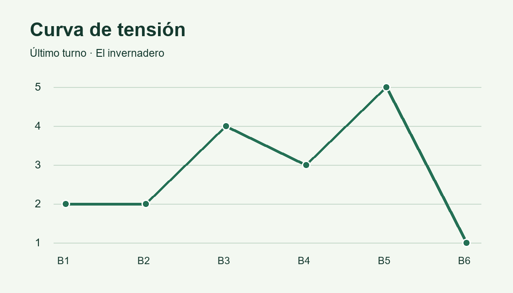

# Estructura del nivel

| Beat y acto | Cambio y acción | Tensión / dificultad | Señal y avance |
|---|---|---|---|
| B1 · I · Apagón | Lina entra al taller y se acerca al banco. | 2/5 por el aviso. Baja, solo caminar. | «Ciclo de riego interrumpido». Al acercarse al banco empieza B2. |
| B2 · I · Práctica | Recoge la batería, la prueba en el banco y la retira. | 2/5 por la práctica segura. Baja, con instrucciones. | «Batería lista». Recupera la batería y entra al corredor. |
| B3 · II · Desvío | Encuentra una barrera y lleva la batería por la pasarela. | 4/5 porque pierde el camino directo. Media, exige leer el espacio. | «Paso inundado» y flechas hacia la antesala. |
| B4 · II · Lectura | Consulta el plano que distingue riego y ventilación. | 3/5, pausa de lectura. Baja, plano visible desde el acceso. | La gota identifica el riego. Entra al control con la batería probada. |
| B5 · III · Conexión | Usa E junto a la toma elegida. | 5/5, la elección resuelve la meta. Media, debe aplicar la pista. | Riego inicia los aspersores. Ventilación rechaza la batería y permite corregir. |
| B6 · III · Riego | Observa los aspersores y cruza la salida. | 1/5 porque el conflicto se resuelve. Baja, solo caminar. | «Riego restablecido» y salida habilitada. |

Ruta principal: B1 → B2 → B3 → B4 → B5 → B6. Si falla en B5, puede reintentar en la misma sala o regresar a B4 y volver a B5. Si deja la batería, puede recogerla donde la soltó. B2 enseña la interacción que resuelve B5. El descenso B3–B4 da tiempo de leer y el ascenso B4–B5 concentra la decisión.
